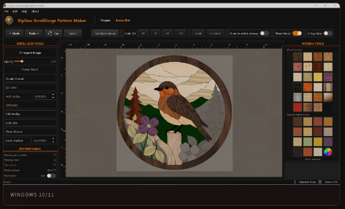
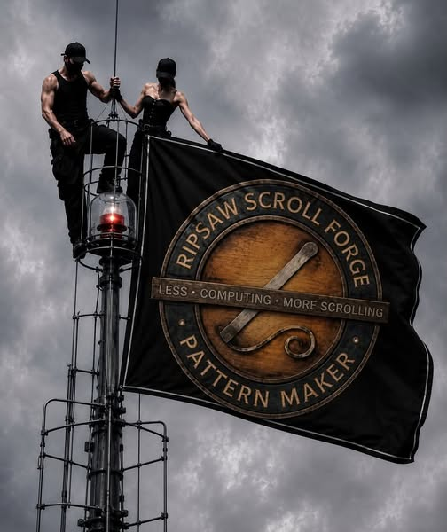

# Help build RipSaw ScrollForge.

**Seeking a technical collaborator**  
Python · PySide6 / Qt · Shapely · Desktop CAD

I’m Roberta, the founder and solo developer behind **RipSaw ScrollForge®**, a specialized desktop CAD application for scroll saw artists. **I’m looking for an experienced developer or engineer to help me build its next release.**

The work includes interactive drawing tools, computational geometry, and desktop application architecture. If you have experience in **Python, PySide6/Qt, Shapely, or desktop CAD**, I’d like to talk with you about where your expertise could help.

You would be working on a product with paying users, eleven beta testers, and direct feedback from practicing artists. I bring the product vision, the community relationships, and a deep understanding of the work this software needs to support.

**[Let’s talk about working together](mailto:info@forgepatterns.com).** Tell me a little about yourself, what you’ve built, and which parts of the work interest you. The scope and terms of any collaboration would be discussed individually. RipSaw’s source repositories remain private; access would follow an agreed working relationship.

  <a href="https://forgepatterns.com/">Explore RipSaw ScrollForge</a>

## Where I need technical help

**Python · PySide6 / Qt · Shapely**

A pattern eventually becomes a set of cuts in real wood. The geometry, the artist’s decisions, and the printed pattern have to agree.

I’m looking for help with:

- Interactive drawing, node editing, and proximity snapping.
- Shared boundaries and pieces derived from source lines.
- Reliable geometry operations that preserve the artist’s intent.
- Piece identity, wood selections, grain direction, and annotations.
- Accurate PDF output that matches the design on the canvas.
- Clear component responsibilities, meaningful tests, and a responsive desktop interface.

I care about getting those foundations right. Artists should be able to concentrate on their work without having to understand what the geometry engine is doing underneath it.

**Less Computing · More Scrolling.**

## A product shaped by its artists

RipSaw is shaped by the people at the scroll saw. They tell me what they need, what gets in their way, and how the tools should behave. My responsibility is to turn that knowledge into software they can use with confidence.

The first release has sold **almost 100 copies**. Eleven beta testers have helped shape the application, including internationally recognized intarsia artists. Members of our community are already creating patterns with RipSaw and sharing their work.

Licensed versions are available for **Windows 10/11 and macOS**. I’m now building a substantial new release, with a particular focus on intarsia and segmentation. By popular request, I’m reopening sales of the existing release the week of November 9, 2026, while development of the next release continues.

*A view of the existing application. The next release is in development.*

## Who you’d be working with

I’m a scroller, and I’m building RipSaw with AI coding assistance while working directly with the artists who use it. My background is in systems consulting, project management, and understanding what people need from software.

RipSaw began with an idea that came to me in a dream in November 2025, and a question I couldn’t leave alone: why didn’t the artists in my community have software built around the way they actually work? After repeated market research and conversations with experienced artists, I found no equivalent that met the need I was trying to address. So I started building it.

I value clear explanations, honest disagreement, careful architecture, and respect for the people depending on the finished product. I’m looking for someone who finds the work meaningful and wants to get it right. If you’re also a scroller, we already have something to talk about.

**[Get in touch](mailto:info@forgepatterns.com)** to talk about collaborating, or visit [ForgePatterns.com](https://forgepatterns.com/) to learn more about the application.

## Founded on faith, with more ahead

My Christian faith is at the heart of why I’m doing this. Working with my hands, cutting, sanding, and fitting pieces together, is deeply meaningful to me. I want RipSaw to help others experience the satisfaction of making something of their own.

For now, my work is focused on delivering the next RipSaw release. Beyond it, I want to keep serving more of the scrolling community through fretwork, scroll saw sign making, and layering.

## A flag from the community

  

This flag design came from a beta tester as a way to say thank you for creating RipSaw. It still humbles me.

That’s the community behind this application. I’m humbled to be building it with them.

<strong>Your ideas, forged.</strong>

© 2026 Roberta Matera. All rights reserved. RipSaw ScrollForge®, Forged Kids®, and Forge Mark® are registered trademarks. RipSaw ScrollForge software: patent pending.

